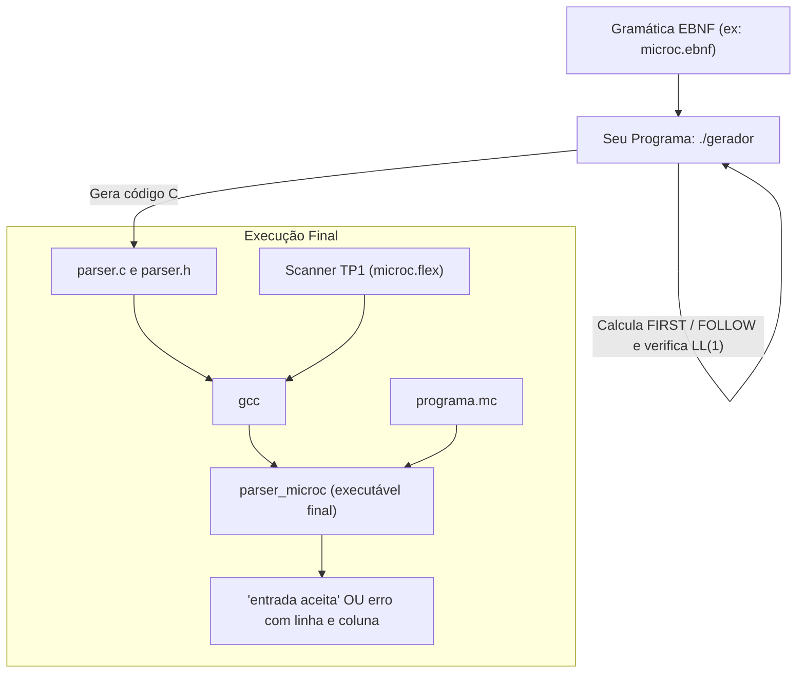

## 1. O que é o Trabalho 2? (Visão Geral)

### A diferença fundamental entre o TP1 e o TP2

* **No Trabalho 1 (Análise Léxica):**
  Você usou o Flex para construir um **leitor de palavras** (*scanner*). O TP1 lia caracteres do arquivo (como `i`, `f`, ` `, `(`, `x`, ` `, `>`, ` `, `0`, `)`) e agrupava em **tokens** (`IF`, `LPAREN`, `ID("x")`, `GT`, `INTEGERCONST("0")`, `RPAREN`).
  > O scanner do TP1 **não se importava com a ordem** das palavras. Se você passasse `else 123 if ) + ;`, o TP1 dizia que todos os tokens eram válidos, mesmo que isso não fizesse o menor sentido como código em C.

* **No Trabalho 2 (Análise Sintática):**
  Agora entra o **analisador sintático** (*parser*). O objetivo do parser é pegar aquela sequência de tokens entregue pelo léxico e verificar se ela respeita as **regras gramaticais** da linguagem (por exemplo: um `if` obrigatoriamente precisa ser seguido de `(`, depois uma expressão, depois `)` e um bloco ou comando).

### Mas o Trabalho 2 NÃO é apenas um parser! Ele é um GERADOR de parsers

Você não programou um parser fixo apenas para Micro C. **Você construiu uma ferramenta parecida com o Yacc / Bison ou ANTLR**. 

O seu programa executável [`./gerador`](file:///home/maykon/Trabalho/Trabalho_2/gerador):
1. **Lê uma especificação de gramática** escrita em notação EBNF (como [`testes/gramaticas/microc.ebnf`](file:///home/maykon/Trabalho/Trabalho_2/testes/gramaticas/microc.ebnf) ou [`json.ebnf`](file:///home/maykon/Trabalho/Trabalho_2/testes/gramaticas/json.ebnf)).
2. **Faz auditoria matemática da gramática**: descobre se existem regras que nunca terminam (recursão à esquerda), símbolos inalcançáveis, regras inúteis (improdutivas) ou ambiguidades (conflitos LL(1)).
3. **Escreve sozinho um programa em C** (`parser.c` e `parser.h`): gera código C com funções recursivas (`parse_programa()`, `parse_comando()`, etc.) para reconhecer aquela linguagem!
4. Esse `parser.c` gerado é então compilado com o compilador C (`gcc`) e vira o analisador final da linguagem.

---

## 2. O que foi implementado em cada arquivo e função?

### 1. Leitura da Notação EBNF: [`src/ebnf_parser.c`](file:///home/maykon/Trabalho/Trabalho_2/src/ebnf_parser.c)
Este módulo é o parser da *própria gramática*. Ele lê o arquivo `.ebnf` e monta uma árvore sintática interna (estrutura `Expr`) em memória.

* **`parse_expr(Lexer *l)`**: 
  Lê uma expressão gramatical que pode ter alternativas separadas por barra vertical `|` (ex: `A | B | C`). Se houver `|`, cria nós do tipo `E_ALT` ligando as opções.
* **`parse_seq(Lexer *l)`**: 
  Lê elementos que acontecem em sequência (um atrás do outro, ex: `tipo ID ';'`). Ele vai consumindo fatores enquanto não encontra um separador de alternativa `|` ou delimitadores de fechamento, agrupando-os em nós `E_SEQ`.
* **`parse_fator(Lexer *l)`**: 
  Reconhece as unidades básicas da regra:
  * Identificadores não-terminais (`E_NAOTERM`)
  * Literais como `';'` ou `'while'` (`E_TERM`)
  * Colchetes `[ expr ]` para elementos opcionais (`E_OPC`)
  * Chaves `{ expr }` para repetições de zero ou mais vezes (`E_REP`)
  * Parênteses `( expr )` para agrupamento

---

### 2. Verificações Semânticas da Gramática: [`src/verificacao.c`](file:///home/maykon/Trabalho/Trabalho_2/src/verificacao.c)
Antes de gerar código, o gerador precisa saber se a gramática é sã.

* **`verif_inalcancaveis(Gramatica *g)`**:
  Inicia a busca a partir do símbolo inicial (geralmente a primeira regra) e marca todos os não-terminais que podem ser atingidos. Se algum não-terminal foi definido mas nunca é chamado por ninguém, emite um **aviso** de símbolo inalcançável.
* **`verif_improdutivos(Gramatica *g)`**:
  Descobre se existem não-terminais que entram em loop infinito e nunca conseguem produzir uma sequência de tokens reais (terminais). Usa um algoritmo de ponto fixo. Se achar algum, emite um **erro** de símbolo improdutivo.
* **`verif_recursao_esquerda(Gramatica *g)`**:
  Parsers descendentes recursivos travam em loop infinito se uma regra se chama logo no início dela mesma (ex: `expr = expr '+' termo`). Essa função:
  1. Detecta recursão direta (`A -> A ...`).
  2. Detecta recursão indireta (`A -> B ...` onde `B -> A ...`), inclusive considerando símbolos intermediários que podem sumir (anuláveis), calculando o fecho transitivo (algoritmo de Floyd-Warshall). Se houver, acusa erro fatal.

---

### 3. Teoria de Compiladores (Conjuntos Sintáticos): [`src/conjuntos.c`](file:///home/maykon/Trabalho/Trabalho_2/src/conjuntos.c)
Para um parser LL(1) tomar decisões olhando apenas o próximo token (lookahead de 1), ele precisa saber quem pode aparecer onde.

* **`conj_anulavel(Gramatica *g)`**:
  Determina quais regras e expressões podem derivar a palavra vazia ($\varepsilon$). Por exemplo, `[ 'else' comando ]` é anulável porque pode simplesmente não aparecer.
* **`conj_first(Gramatica *g)`**:
  Calcula o conjunto de todos os tokens que podem **iniciar** uma determinada regra ou expressão. Se a regra for `comando = 'if' ... | 'while' ...`, o FIRST dessa regra contém `{ 'if', 'while' }`.
* **`conj_follow(Gramatica *g)`**:
  Calcula quais tokens podem aparecer imediatamente **após** um não-terminal na gramática. O símbolo inicial sempre contém o fim de arquivo (`$`) em seu FOLLOW.

---

### 4. Validação da Condição LL(1): [`src/ll1.c`](file:///home/maykon/Trabalho/Trabalho_2/src/ll1.c)
Garante que o parser nunca terá dúvidas sobre qual caminho seguir com 1 token de consulta.

* **`verificar_expr(Gramatica *g, int nt_idx, const Expr *e, const BitSet *follow_nt)`**:
  Testa as três condições formais de LL(1):
  1. **Em alternativas `A | B`:** o FIRST de `A` e o FIRST de `B` não podem ter nenhum token em comum (senão o parser não saberia qual escolher).
  2. **Se uma das alternativas for anulável:** o FIRST das outras não pode se cruzar com o FOLLOW da regra.
  3. **Em repetições `{ A }` e opcionais `[ A ]`:** o FIRST do conteúdo não pode se cruzar com o FOLLOW do que vem depois (com exceção do clássico *dangling else*, que é resolvido de forma gulosa com um aviso).
* **`ll1_verificar(Gramatica *g)`**:
  Percorre todas as regras da gramática aplicando `verificar_expr`. Se houver conflito grave, impede a geração de código.

---

### 5. Geração Automática de Código C: [`src/codegen.c`](file:///home/maykon/Trabalho/Trabalho_2/src/codegen.c)
É o "motor" que escreve o arquivo `parser.c`.

* **`gen_expr(Emissor *em, const Gramatica *g, const Expr *e)`**:
  Traduz cada nó da árvore sintática em código C imperativo:
  * `E_SEQ`: emite a chamada de cada passo sequencialmente.
  * `E_ALT`: emite blocos `if (pertence(tok.tipo, conj_A)) { ... } else if (...) { ... } else { erro_sintatico(...); }`.
  * `E_OPC`: emite `if (pertence(tok.tipo, conj_opc)) { ... }`.
  * `E_REP`: emite `while (pertence(tok.tipo, conj_rep)) { ... }`.
  * `E_TERM`: emite `match(TOKEN_XYZ);` (verifica se o token atual é o esperado e consome).
  * `E_NAOTERM`: emite `parse_nome_da_regra();` (a chamada de função recursiva).
* **`gen_casamento_regex(FILE *f, const char *nome_c, const char *regex)`**:
  Quando uma gramática pura declara tokens com expressões regulares (como em `expr.ebnf` ou `json.ebnf`), esta função constrói um **Autômato Finito Não-Determinístico (NFA de Thompson)**, converte-o para **Autômato Finito Determinístico (DFA)** por construção de subconjuntos, e escreve uma função em C com `switch (estado)` que faz a leitura do lexema no arquivo sem precisar de biblioteca externa!
* **`gen_token_de_arquivo(FILE *f, int microc)`**:
  Gera a função que permite ao parser rodar no modo `--tokens`, lendo uma lista de tokens já extraídos previamente de um arquivo de texto.
* **`gerar_limpar_recursos` e integração com `atexit`**:
  Gera o gerenciamento de desalocação no código final para garantir que buffers do Flex, arquivos abertos e memória alocada sejam liberados mesmo quando ocorre um `exit(EXIT_FAILURE)` por erro sintático (atendendo ao requisito de zero vazamentos no Valgrind).

---

### 6. Integração do Micro C: [`src/microc_mapa.c`](file:///home/maykon/Trabalho/Trabalho_2/src/microc_mapa.c)
* **`microc_carregar_tokens_h(const char *caminho)`**:
  Lê o arquivo `tokens.h` herdado do TP1, faz um parse simples da definição `typedef enum { ... } TokenType;` e armazena os nomes dos tokens e seus valores inteiros em uma tabela hash/mapa em memória. Assim, o gerador sabe que o literal `"+"`, por exemplo, corresponde ao enum `PLUS` no seu compilador.

---

### 7. Scanner Adaptado: [`microc/microc.flex`](file:///home/maykon/Trabalho/Trabalho_2/microc/microc.flex) e [`microc/scanner.c`](file:///home/maykon/Trabalho/Trabalho_2/microc/scanner.c)
Aqui o seu Trabalho 1 foi conectado ao Trabalho 2:

* **Em [`microc.flex`](file:///home/maykon/Trabalho/Trabalho_2/microc/microc.flex):**
  * Removemos a função `main()` do TP1 (pois quem manda agora é o `main` do parser gerado).
  * Removemos a macro/função conflitante `yywrap()`.
  * Adicionamos a função `libera_tabela_simbolos()` para limpar a memória da tabela de identificadores e strings ao final da execução.
  * O prefixo dos símbolos foi padronizado como `microc_yy` (`microc_yylex`, `microc_yytext`, etc.).
* **Em [`microc/scanner.c`](file:///home/maykon/Trabalho/Trabalho_2/microc/scanner.c):**
  * Atua como uma ponte (adaptador): a cada chamada de `proximo_token()`, ele chama `microc_yylex()` do seu TP1, recupera o texto de `microc_yylval.symbol` (com os escapes já convertidos do TP1) e monta o objeto `Token { tipo, lexema, linha }` esperado pelo parser gerado.
  * `scanner_finalizar()`: invoca a limpeza da tabela de símbolos e `microc_yylex_destroy()`.

---

## Em resumo: como tudo se encaixa na prática

1. Você digita `make`.
2. O Makefile compila o seu [`./gerador`](file:///home/maykon/Trabalho/Trabalho_2/gerador).
3. O Makefile roda o gerador passando a gramática [`microc.ebnf`](file:///home/maykon/Trabalho/Trabalho_2/testes/gramaticas/microc.ebnf).
4. O gerador calcula FIRST/FOLLOW, valida LL(1) e cospe [`build/microc/parser.c`](file:///home/maykon/Trabalho/Trabalho_2/build/microc/parser.c).
5. O Makefile compila o Flex [`microc.flex`](file:///home/maykon/Trabalho/Trabalho_2/microc/microc.flex) + o adaptador [`scanner.c`](file:///home/maykon/Trabalho/Trabalho_2/microc/scanner.c) + o [`parser.c`](file:///home/maykon/Trabalho/Trabalho_2/build/microc/parser.c) gerado.
6. O resultado final é o executável `build/microc/parser_microc`, capaz de receber qualquer arquivo `.mc`, analisar léxica e sintaticamente e dizer se o programa está correto ou em qual linha e coluna ocorreu o erro!